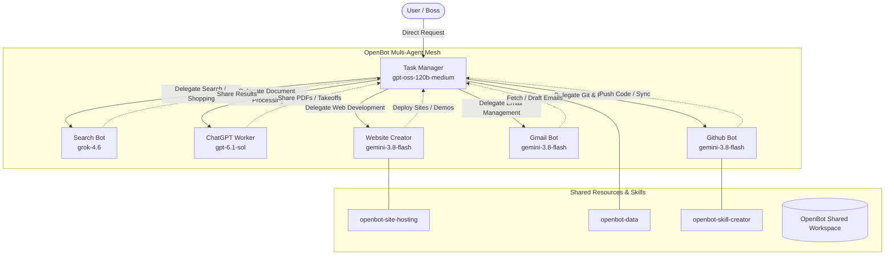

# OpenBot Team Architecture & Collaboration

## Agent Roles & Responsibilities

| Agent | Model | Provider | Core Responsibilities |
|---|---|---|---|
| **Task Manager** | `gpt-oss-120b-medium` | Antigravity | Central orchestrator. Coordinates multi-step workflows, delegates subtasks, and combines deliverables. |
| **Search Bot** | `grok-4.6` | Grok | Deep web research, comparative pricing, materials pricing analysis, and structured catalog comparisons. |
| **ChatGPT Worker** | `gpt-6.1-sol` | Codex | Complex analysis, video/transcript processing, statement-of-work (SOW) parsing, and takeoff generation. |
| **Website Creator** | `gemini-3.8-flash` | Antigravity | Full-stack frontend development, catalog generators, interactive presentations, and local site hosting. |
| **Gmail** | `gemini-3.8-flash` | Antigravity | Monitoring, reviewing, summarizing incoming client/vendor emails, and staging drafted replies. |
| **Github Bot** | `gemini-3.8-flash` | Antigravity | Managing git branches, commits, PRs, releases, issue tracking, and repository lifecycle. |
